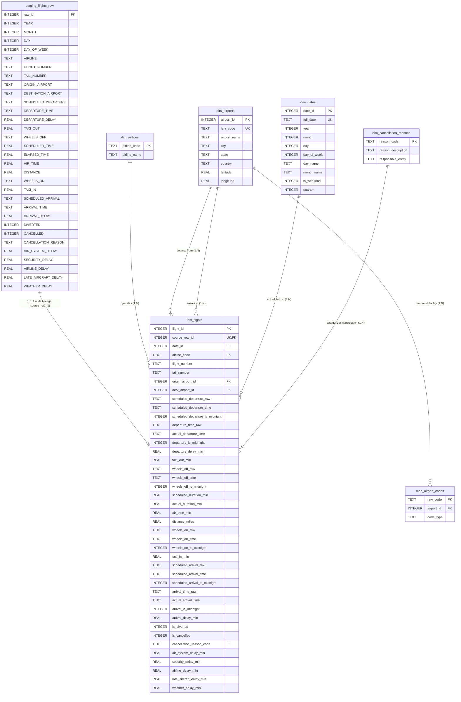

# FlightPulse - Relational Database Architecture & Design Specification (Final)

This document presents the finalized relational database architecture for **FlightPulse**, an airline operations and flight delay analytics platform powered by **SQLite**.

The design establishes a **Two-Tier Staging-to-Dimensional Processing Model**:
1. **Raw Staging Layer (`staging_flights_raw`)**: An unmutated landing table preserving all 31 original flight columns exactly as loaded from `flights.csv`.
2. **Analytical Dimensional Layer (`fact_flights` & Dimension Tables)**: A normalized schema engineered for high-performance analytical queries, route delay aggregations, carrier punctuality metrics, and seasonal analysis. Every record in `fact_flights` references `staging_flights_raw.raw_id` via `source_row_id` with complete data lineage.

---

## 1. High-Level Architecture & Entity-Relationship Diagram



---

## 2. Staging-to-Fact Cardinality & Completeness Validation

### 2.1 Formal Cardinality: $1 : 0..1$
- In the physical relational schema:
  - `fact_flights.source_row_id` is defined as `INTEGER NOT NULL UNIQUE REFERENCES staging_flights_raw(raw_id)`.
  - Every fact record points to **exactly one** staging row.
  - Because `staging_flights_raw.raw_id` is the parent key, database constraints alone guarantee only that a staging record cannot appear more than once in the fact table. They do **not** structurally guarantee that every staging row has already been loaded into `fact_flights`.
  - Therefore, the true relational cardinality is **$1 : 0..1$** (each staging record corresponds to zero or one fact record).

### 2.2 ETL Completeness Verification Requirement
To fulfill the project requirement that **100% of raw flight records (all 5,819,079 rows) are represented** in `fact_flights`:
- The ETL pipeline must execute an automated completeness validation immediately after the transformation stage:
  ```sql
  -- Verification Check: Fact count must equal staging count exactly
  SELECT 
      (SELECT COUNT(*) FROM staging_flights_raw) AS staging_count,
      (SELECT COUNT(*) FROM fact_flights) AS fact_count,
      (SELECT COUNT(*) FROM staging_flights_raw WHERE raw_id NOT IN (SELECT source_row_id FROM fact_flights)) AS unmapped_staging_rows;
  ```
- If `unmapped_staging_rows > 0`, the ETL pipeline must raise a fatal integrity exception and roll back the transaction.

---

## 3. Full Traceability Mapping: 31 Staging Columns to Analytical Schema

### 3.1 Preserving Operational Values (Diverted & Cancelled Flights Policy)
> [!IMPORTANT]
> **Preservation Principle**: Operational values (`ELAPSED_TIME`, `AIR_TIME`, `TAXI_IN`, `WHEELS_ON`, `ARRIVAL_TIME`, `TAXI_OUT`, `WHEELS_OFF`, `DEPARTURE_TIME`) are **never artificially overwritten or coerced to `NULL`** based solely on `DIVERTED = 1` or `CANCELLED = 1`.
> - In raw aviation datasets, a diverted flight frequently records valid pushback, taxi-out, takeoff (`WHEELS_OFF`), and landing (`WHEELS_ON`, `TAXI_IN`, `ARRIVAL_TIME` at the diverted diversion airport).
> - Every source value present in the raw data is faithfully preserved in `fact_flights`.
> - A column in `fact_flights` is populated with `NULL` **if and only if** the raw source value itself was missing/null.
> - The cancellation (`is_cancelled`) and diversion (`is_diverted`) flags remain strictly separate from the availability of actual physical measurements.

| # | Staging Column (`staging_flights_raw`) | Target Analytical Table & Column | Mapping Strategy & Value Preservation Policy |
|:---:|:---|:---|:---|
| 1 | `YEAR` | `dim_dates.year` / via `date_id` | Normalized into `dim_dates`; constant `2015`. |
| 2 | `MONTH` | `dim_dates.month` / via `date_id` | Normalized into `dim_dates` (1–12). |
| 3 | `DAY` | `dim_dates.day` / via `date_id` | Normalized into `dim_dates` (1–31). |
| 4 | `DAY_OF_WEEK` | `dim_dates.day_of_week` / via `date_id` | Normalized into `dim_dates` (1 = Mon, 7 = Sun). |
| 5 | `AIRLINE` | `fact_flights.airline_code` | Normalized; links to `dim_airlines.airline_code`. |
| 6 | `FLIGHT_NUMBER` | `fact_flights.flight_number` | Preserved directly as `TEXT`. |
| 7 | `TAIL_NUMBER` | `fact_flights.tail_number` | Preserved directly as `TEXT` (`dim_aircraft` deferred). Null only if source was null. |
| 8 | `ORIGIN_AIRPORT` | `fact_flights.origin_airport_id` | Resolved via `map_airport_codes.raw_code` $\rightarrow$ `dim_airports.airport_id`. |
| 9 | `DESTINATION_AIRPORT` | `fact_flights.dest_airport_id` | Resolved via `map_airport_codes.raw_code` $\rightarrow$ `dim_airports.airport_id`. |
| 10 | `SCHEDULED_DEPARTURE` | `scheduled_departure_raw`, `scheduled_departure_time`, `scheduled_departure_is_midnight` | Literal raw string (e.g. `'5'`), normalized `'00:05'`, and midnight marker (0). |
| 11 | `DEPARTURE_TIME` | `departure_time_raw`, `actual_departure_time`, `departure_is_midnight` | Literal raw string (e.g. `'2400'`), normalized `'00:00'`, and midnight marker (1 if `2400`, else 0). Null if cancelled. |
| 12 | `DEPARTURE_DELAY` | `fact_flights.departure_delay_min` | Preserved as `REAL` minutes. Null only when source is null. |
| 13 | `TAXI_OUT` | `fact_flights.taxi_out_min` | Preserved as `REAL` minutes. Null only when source is null. |
| 14 | `WHEELS_OFF` | `wheels_off_raw`, `wheels_off_time`, `wheels_off_is_midnight` | Literal raw string, normalized `'HH:MM'`, and midnight marker (1 if `2400`, else 0). |
| 15 | `SCHEDULED_TIME` | `fact_flights.scheduled_duration_min` | Preserved as `REAL` block minutes. Null only when source is null. |
| 16 | `ELAPSED_TIME` | `fact_flights.actual_duration_min` | Preserved as `REAL` elapsed minutes whenever present in source. Never forced to NULL by diversion flag. |
| 17 | `AIR_TIME` | `fact_flights.air_time_min` | Preserved as `REAL` airborne minutes whenever present in source. Never forced to NULL by diversion flag. |
| 18 | `DISTANCE` | `fact_flights.distance_miles` | Preserved as `REAL` statute miles. |
| 19 | `WHEELS_ON` | `wheels_on_raw`, `wheels_on_time`, `wheels_on_is_midnight` | Literal raw string, normalized `'HH:MM'`, and midnight marker (1 if `2400`, else 0). Preserved on diverted flights. |
| 20 | `TAXI_IN` | `fact_flights.taxi_in_min` | Preserved as `REAL` minutes. Populated on diverted flights if taxi-in occurred. |
| 21 | `SCHEDULED_ARRIVAL` | `scheduled_arrival_raw`, `scheduled_arrival_time`, `scheduled_arrival_is_midnight` | Literal raw string, normalized `'HH:MM'`, and midnight marker (1 if `2400`, else 0). |
| 22 | `ARRIVAL_TIME` | `arrival_time_raw`, `actual_arrival_time`, `arrival_is_midnight` | Literal raw string, normalized `'HH:MM'`, and midnight marker (1 if `2400`, else 0). Preserved on diverted flights. |
| 23 | `ARRIVAL_DELAY` | `fact_flights.arrival_delay_min` | Preserved as `REAL` minutes whenever present in source. |
| 24 | `DIVERTED` | `fact_flights.is_diverted` | Preserved as `INTEGER` binary flag (0 or 1). |
| 25 | `CANCELLED` | `fact_flights.is_cancelled` | Preserved as `INTEGER` binary flag (0 or 1). |
| 26 | `CANCELLATION_REASON` | `fact_flights.cancellation_reason_code` | Normalized; links to `dim_cancellation_reasons.reason_code`. Null for completed flights. |
| 27 | `AIR_SYSTEM_DELAY` | `fact_flights.air_system_delay_min` | Preserved as `REAL` minutes. Null per DOT rules when delay $< 15$. |
| 28 | `SECURITY_DELAY` | `fact_flights.security_delay_min` | Preserved as `REAL` minutes. Null per DOT rules when delay $< 15$. |
| 29 | `AIRLINE_DELAY` | `fact_flights.airline_delay_min` | Preserved as `REAL` minutes. Null per DOT rules when delay $< 15$. |
| 30 | `LATE_AIRCRAFT_DELAY` | `fact_flights.late_aircraft_delay_min` | Preserved as `REAL` minutes. Null per DOT rules when delay $< 15$. |
| 31 | `WEATHER_DELAY` | `fact_flights.weather_delay_min` | Preserved as `REAL` minutes. Null per DOT rules when delay $< 15$. |
| - | *(Ingestion ID)* | `fact_flights.source_row_id` | **1:0..1 FK referencing `staging_flights_raw.raw_id`**. |

---

## 4. Time-Field Semantics, Exact Raw Values, and `2400` Normalization

### 4.1 Strict Distinction of Three Core Concepts
To prevent data distortion and invalid temporal arithmetic, the database architecture explicitly decouples three separate concepts:
1. **Source `2400` Representation**: A legacy operational convention in FAA/DOT records where `2400` designates the exact end-of-day midnight boundary on the origin or destination clock, rather than `0000` (which designates the start of a day).
2. **Calendar-Day Rollover**: A flight can depart on Day $D$ and arrive on Day $D+1$ (or even $D+2$) based on elapsed flight duration or severe delays—even when arrival time is an ordinary clock value like `0100` or `1530`. The marker for `2400` **does not by itself determine calendar-day rollover**.
3. **Actual Timestamp & Time-Zone Reconstruction**: Departure times are recorded in the origin airport's local civil time, while arrival times are recorded in the destination airport's local civil time. Converting local clock observations into absolute UTC timestamps requires verified airport time-zone identifiers and daylight-saving rules. **The initial schema avoids fabricating or inferring absolute event timestamps without authoritative timezone reference data.**

### 4.2 Exact Raw-Value Preservation
The raw traceability columns (`_raw TEXT`) retain the literal string as parsed from the CSV:
- Raw `5` $\longrightarrow$ stored literally as `'5'` (never pre-padded in the raw column).
- Raw `830` $\longrightarrow$ stored literally as `'830'`.
- Raw `2400` $\longrightarrow$ stored literally as `'2400'`.

Only the derived normalized column (`_time TEXT`) contains the standard zero-padded 24-hour time representation:
- Raw `'5'` $\longrightarrow$ normalized to `'00:05'`.
- Raw `'830'` $\longrightarrow$ normalized to `'08:30'`.
- Raw `'2400'` $\longrightarrow$ normalized to `'00:00'`, with its corresponding midnight indicator set to `1`.

> [!NOTE]
> Under standard ISO-8601 specifications, valid time-of-day strings range strictly from `00:00` to `23:59`. A string like `24:00` is **not** a conventional time-of-day value and breaks SQLite datetime functions and BI tools. Normalizing `2400` to `00:00` with an explicit midnight marker flag preserves the source semantic without violating standard time formats.

### 4.3 Exact Census of Raw `2400` Occurrences in `flights.csv`
An exhaustive census across all **5,819,079 rows** of the scanned 2015 source dataset established the exact counts of raw `2400` values across the six time columns:

| Time Column | Total Evaluated Records | Actual Count of Raw `2400` | % of Non-Null Column Values | Operational Interpretation |
|:---|:---:|:---:|:---:|:---|
| `SCHEDULED_DEPARTURE` | 5,819,079 | **0** | 0.0000% | Timetables do not publish 2400 departures. |
| `DEPARTURE_TIME` | 5,732,926 | **513** | 0.0089% | Actual pushback at the exact end-of-day midnight mark. |
| `WHEELS_OFF` | 5,730,032 | **727** | 0.0127% | Runway takeoff at the exact end-of-day midnight mark. |
| `WHEELS_ON` | 5,726,566 | **2,005** | 0.0350% | Runway touchdown at the exact end-of-day midnight mark. |
| `SCHEDULED_ARRIVAL` | 5,819,079 | **2** | 0.00003% | Published scheduled arrival at midnight. |
| `ARRIVAL_TIME` | 5,726,566 | **2,456** | 0.0429% | Gate arrival at the exact end-of-day midnight mark. |
| **Total `2400` Occurrences** | - | **5,703** | - | - |

### 4.4 Future Timestamp Reconstruction Specification
Full event timestamp reconstruction (e.g. constructing complete UTC ISO-8601 timestamps such as `2015-01-01T23:54:00-05:00`) is deferred to a dedicated analytical transformation step:
- **Required Inputs**:
  1. Flight departure date (`dim_dates.full_date` linked via `date_id`).
  2. Local scheduled and actual time components (`_time`).
  3. Verified IANA time-zone coordinates for each airport (`America/New_York`, `America/Chicago`, etc.) with daylight-saving transitions.
  4. Block duration (`SCHEDULED_TIME`, `ELAPSED_TIME`, `AIR_TIME`) to establish exact overnight flight rollover.
- **Initial Schema Stance**: Retain the literal raw string and normalized local time. Never guess or fabricate rollover dates without timezone data.

### 4.5 Invalid-Time Warning and Audit Protocol
The complete census of all 5,819,079 rows in the scanned 2015 source dataset confirmed **0 invalid time values** (all non-null values are valid integers between `1` and `2400` with minute components $< 60$).

To protect against corruption in future data refreshes:
- **Missing vs Invalid Distinction**:
  - Missing values (`NULL` / empty) remain `NULL` in both `_raw` and `_time`.
  - Invalid values (e.g. `HH > 24`, `MM >= 60`, negative values, or non-numeric garbage) retain the literal text in `_raw`, while `_time` is set to `NULL`.
- **ETL Audit / Reject Output**:
  Whenever an invalid time value is detected during ETL staging:
  1. The record is not silently converted to a valid synthetic time.
  2. A warning entry is written to `etl_warning_log` / `etl_rejected_records` recording: `source_row_id`, column name, raw input string, validation error code (`INVALID_HOUR`, `INVALID_MINUTE`, etc.), and timestamp.

---

## 5. Detailed Schema Specifications

### 5.1 Raw Staging Table: `staging_flights_raw`
- **Role**: Exact physical landing mirror of `flights.csv` (5,819,079 rows, 31 columns).
- **Primary Key**: `raw_id INTEGER PRIMARY KEY AUTOINCREMENT`.
- Unindexed during initial bulk load for maximum ingestion throughput.

---

### 5.2 Simplified Airport Code Bridge: `map_airport_codes`
The redundant `iata_code` column and foreign key have been removed. `airport_id` serves as the sole canonical reference:

```sql
CREATE TABLE map_airport_codes (
    raw_code    TEXT PRIMARY KEY,
    airport_id  INTEGER NOT NULL,
    code_type   TEXT NOT NULL CHECK (code_type IN ('IATA', 'DOT_ID')),
    FOREIGN KEY (airport_id) REFERENCES dim_airports(airport_id)
);
```

- **Clean Cardinality**:
  - `dim_airports` ($1$) $\longrightarrow$ ($N$) `map_airport_codes`.
  - For standard 3-letter IATA codes: `'ATL'` $\rightarrow$ `airport_id = 20`.
  - For October 2015 5-digit DOT numeric IDs: `'10397'` $\rightarrow$ `airport_id = 20`.

---

### 5.3 Analytical Fact Table: `fact_flights`

```sql
CREATE TABLE fact_flights (
    flight_id                           INTEGER PRIMARY KEY AUTOINCREMENT,
    source_row_id                       INTEGER NOT NULL UNIQUE,
    date_id                             INTEGER NOT NULL,
    airline_code                        TEXT NOT NULL,
    flight_number                       TEXT NOT NULL,
    tail_number                         TEXT,
    origin_airport_id                   INTEGER NOT NULL,
    dest_airport_id                     INTEGER NOT NULL,
    
    -- Scheduled Departure
    scheduled_departure_raw             TEXT NOT NULL,
    scheduled_departure_time            TEXT NOT NULL,
    scheduled_departure_is_midnight     INTEGER NOT NULL DEFAULT 0,
    
    -- Actual Departure
    departure_time_raw                  TEXT,
    actual_departure_time               TEXT,
    departure_is_midnight               INTEGER,
    departure_delay_min                 REAL,
    
    -- Ground Operations & Taxiing (Preserved whenever recorded, including diverted flights)
    taxi_out_min                        REAL,
    wheels_off_raw                      TEXT,
    wheels_off_time                     TEXT,
    wheels_off_is_midnight              INTEGER,
    wheels_on_raw                       TEXT,
    wheels_on_time                      TEXT,
    wheels_on_is_midnight               INTEGER,
    taxi_in_min                         REAL,
    
    -- Flight Duration & Distance Metrics
    scheduled_duration_min              REAL,
    actual_duration_min                 REAL,
    air_time_min                        REAL,
    distance_miles                      REAL NOT NULL,
    
    -- Scheduled Arrival
    scheduled_arrival_raw               TEXT NOT NULL,
    scheduled_arrival_time              TEXT NOT NULL,
    scheduled_arrival_is_midnight       INTEGER NOT NULL DEFAULT 0,
    
    -- Actual Arrival
    arrival_time_raw                    TEXT,
    actual_arrival_time                 TEXT,
    arrival_is_midnight                 INTEGER,
    arrival_delay_min                   REAL,
    
    -- Flight Status Flags
    is_diverted                         INTEGER NOT NULL DEFAULT 0,
    is_cancelled                        INTEGER NOT NULL DEFAULT 0,
    cancellation_reason_code            TEXT,
    
    -- Causal Delay Metrics (Populated strictly when arrival_delay_min >= 15 per DOT rules)
    air_system_delay_min                REAL,
    security_delay_min                  REAL,
    airline_delay_min                   REAL,
    late_aircraft_delay_min             REAL,
    weather_delay_min                   REAL,

    -- Foreign Key Constraints
    FOREIGN KEY (source_row_id) REFERENCES staging_flights_raw(raw_id),
    FOREIGN KEY (date_id) REFERENCES dim_dates(date_id),
    FOREIGN KEY (airline_code) REFERENCES dim_airlines(airline_code),
    FOREIGN KEY (origin_airport_id) REFERENCES dim_airports(airport_id),
    FOREIGN KEY (dest_airport_id) REFERENCES dim_airports(airport_id),
    FOREIGN KEY (cancellation_reason_code) REFERENCES dim_cancellation_reasons(reason_code),

    -- Table Integrity Constraints
    CHECK (origin_airport_id != dest_airport_id),
    CHECK (is_diverted IN (0, 1)),
    CHECK (is_cancelled IN (0, 1)),
    CHECK (NOT (is_cancelled = 1 AND is_diverted = 1)),
    CHECK (
        (is_cancelled = 0 AND cancellation_reason_code IS NULL) OR
        (is_cancelled = 1 AND cancellation_reason_code IN ('A', 'B', 'C', 'D'))
    )
);
```

---

## 6. Dimension Tables Specification

1. **`dim_airlines`**:
   - `airline_code TEXT PRIMARY KEY` (14 records: `AA`, `DL`, `UA`, etc.).
   - `airline_name TEXT NOT NULL`.
2. **`dim_airports`**:
   - `airport_id INTEGER PRIMARY KEY AUTOINCREMENT` (322 records).
   - `iata_code TEXT NOT NULL UNIQUE`.
   - `airport_name TEXT NOT NULL`, `city TEXT NOT NULL`, `state TEXT NOT NULL`, `country TEXT NOT NULL DEFAULT 'USA'`.
   - `latitude REAL NULL`, `longitude REAL NULL` (**strictly `NULL` for `ECP`, `PBG`, `UST`** until verified data enrichment).
3. **`dim_dates`**:
   - `date_id INTEGER PRIMARY KEY` (`YYYYMMDD` integer, e.g. `20150101`; 365 records).
   - `full_date TEXT NOT NULL UNIQUE` (`YYYY-MM-DD`).
   - `year`, `month`, `day`, `day_of_week` `INTEGER NOT NULL`.
   - `day_name`, `month_name` `TEXT NOT NULL`.
   - `is_weekend INTEGER NOT NULL CHECK (is_weekend IN (0, 1))`.
   - `quarter INTEGER NOT NULL CHECK (quarter BETWEEN 1 AND 4)`.
4. **`dim_cancellation_reasons`**:
   - `reason_code TEXT PRIMARY KEY` (`A`, `B`, `C`, `D`).
   - `reason_description TEXT NOT NULL` (`Carrier`, `Weather`, `National Aviation System`, `Security`).
   - `responsible_entity TEXT NOT NULL`.

---

## 7. Foreign Key Activation & Staged Indexing Strategy

### 7.1 Foreign Key Enforcement
- SQLite requires explicit activation per connection:
  ```sql
  PRAGMA foreign_keys = ON;
  ```
- All ETL pipeline connections will execute this pragma immediately upon opening.

### 7.2 Two-Stage Bulk Indexing
1. **Bulk Ingestion Stage**:
   - `staging_flights_raw` and `fact_flights` are populated without secondary indexes to avoid insert bottlenecks on 5.82 million rows.
2. **Post-Load Indexing Stage**:
   Once all rows are loaded, the following targeted B-tree indexes are built:
   - `idx_fact_flights_source_row`: `(source_row_id)` — Rapid 1:0..1 staging audit lookups.
   - `idx_fact_flights_date`: `(date_id)` — Time-series and seasonal aggregations.
   - `idx_fact_flights_airline`: `(airline_code)` — Carrier on-time performance queries.
   - `idx_fact_flights_route`: `(origin_airport_id, dest_airport_id)` — City-pair route volume and delays.
   - `idx_fact_flights_origin`: `(origin_airport_id)` — Hub outbound punctuality.
   - `idx_fact_flights_dest`: `(dest_airport_id)` — Destination inbound capacity.
   - `idx_fact_flights_arr_delay`: `(arrival_delay_min)` — Threshold queries ($\ge 15$, $\ge 60$ min).
   - `idx_fact_flights_status`: `(is_cancelled, is_diverted)` — Disruption metrics.
   - `idx_map_airport_codes_raw`: `(raw_code)` — Fast dictionary lookup.
