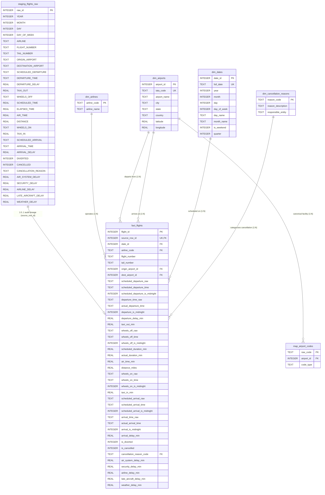

# FlightPulse - Relational Database Relationships & Integrity Guide (Final)

This guide provides the definitive relational relationship reference, Entity-Relationship (ER) model, foreign key constraint matrix, and domain invariants for the **FlightPulse** SQLite database.

---

## 1. Updated Entity-Relationship (ER) Diagram



---

## 2. Table Relationship Matrix & Cardinalities

| Relationship | Parent Table & Key | Child Table & Foreign Key | Cardinality | Delete / Update Rule | Description & Invariant |
|:---|:---|:---|:---|:---|:---|
| **Staging Traceability** | `staging_flights_raw(raw_id)` | `fact_flights(source_row_id)` | **$1 : 0..1$** | `RESTRICT` / `CASCADE` | Traceability lineage. Each staging row corresponds to zero or one fact record; ETL post-load validation asserts full 100% coverage. |
| **Operating Carrier** | `dim_airlines(airline_code)` | `fact_flights(airline_code)` | **$1 : N$** | `RESTRICT` / `CASCADE` | Connects each flight to its certified airline company (14 carriers). |
| **Calendar Schedule** | `dim_dates(date_id)` | `fact_flights(date_id)` | **$1 : N$** | `RESTRICT` / `CASCADE` | Connects each flight to calendar attributes (quarter, month, day, day-of-week). |
| **Departure Origin Hub** | `dim_airports(airport_id)` | `fact_flights(origin_airport_id)` | **$1 : N$** | `RESTRICT` / `CASCADE` | Resolves canonical departure facility geography and administrative details. |
| **Arrival Destination** | `dim_airports(airport_id)` | `fact_flights(dest_airport_id)` | **$1 : N$** | `RESTRICT` / `CASCADE` | Resolves canonical destination facility geography and administrative details. |
| **Dual Airport Code Mapping** | `dim_airports(airport_id)` | `map_airport_codes(airport_id)` | **$1 : N$** | `CASCADE` / `CASCADE` | Maps multiple raw representations (IATA or DOT numeric IDs) to one canonical airport record. |
| **Cancellation Root Cause** | `dim_cancellation_reasons(reason_code)` | `fact_flights(cancellation_reason_code)` | **$1 : N$** | `RESTRICT` / `CASCADE` | Classifies cancelled flights into Carrier, Weather, NAS, or Security causes. |

---

## 3. Detailed Relationship Explanations

### 3.1 Staging Traceability & Completeness Validation ($1 : 0..1$)
```sql
fact_flights.source_row_id INTEGER NOT NULL UNIQUE REFERENCES staging_flights_raw(raw_id)
```
- **Cardinality Nuance**: 
  - Every row in `fact_flights` references exactly one row in `staging_flights_raw`.
  - However, because the constraint is defined on `fact_flights` pointing to `staging_flights_raw`, the database schema itself guarantees only that a staging row cannot be loaded multiple times; it does not structurally force every staging row to be loaded.
  - The formal relational cardinality is therefore **$1 : 0..1$**.
- **ETL Completeness Assertion**:
  To guarantee that no rows are dropped during the transformation pipeline, the ETL process must execute an assertion query immediately following the transformation:
  ```sql
  SELECT COUNT(*) FROM staging_flights_raw 
  WHERE raw_id NOT IN (SELECT source_row_id FROM fact_flights);
  ```
  If this count is greater than 0, the ETL transaction is aborted.

---

### 3.2 Simplified Airport Code Bridge (`map_airport_codes`)
The redundant `iata_code` column and secondary foreign key have been eliminated:
```sql
CREATE TABLE map_airport_codes (
    raw_code    TEXT PRIMARY KEY,
    airport_id  INTEGER NOT NULL,
    code_type   TEXT NOT NULL CHECK (code_type IN ('IATA', 'DOT_ID')),
    FOREIGN KEY (airport_id) REFERENCES dim_airports(airport_id)
);
```
- **Cardinality**: `dim_airports` ($1$) $\longrightarrow$ ($N$) `map_airport_codes`.
- Each physical airport in `dim_airports` has multiple valid raw code representations:
  - Standard 3-letter IATA code: `'JFK'` $\rightarrow$ `airport_id = 166`.
  - October 2015 5-digit DOT numeric ID: `'12478'` $\rightarrow$ `airport_id = 166`.
- Downstream fact table joins use `fact_flights.origin_airport_id = dim_airports.airport_id`, eliminating string manipulation in queries.

---

### 3.3 Deferred `dim_aircraft` and Direct `tail_number` Retention
- `dim_aircraft` is deferred from the initial database implementation.
- `fact_flights.tail_number` stores the raw alphanumeric airframe registration (e.g. `'N407AS'`).
- In `flights.csv`, `TAIL_NUMBER` is null on 14,721 records (0.25%, mostly cancelled flights before aircraft assignment). Retaining it directly in `fact_flights` prevents foreign key failures while retaining full fleet tracking.

---

## 4. Operational Value Preservation & Time Normalization Rules

### 4.1 Preservation of Operational Measurements (Diverted & Cancelled Flights)
- **Principle**: Flight status indicators (`is_cancelled`, `is_diverted`) are descriptive classifications and **must not be used to forcibly NULL out physical measurements**.
- **Diverted Flights**: A diverted flight regularly generates physical observations (e.g., `TAXI_OUT`, `WHEELS_OFF`, airborne flight time, and even landing timestamps `WHEELS_ON`, `TAXI_IN`, and `ARRIVAL_TIME` at the diversion airport). If these measurements exist in the raw source data, they must be preserved in `fact_flights`.
- **Cancelled Flights**: Cancelled flights that experienced taxi-out or pushback prior to gate return retain their recorded times.
- Fields are populated with `NULL` in `fact_flights` **strictly when the underlying source value was missing**.

### 4.2 Exact Raw Values and `2400` Normalization Semantics
1. **Raw Preservation**:
   Raw columns (`_raw TEXT`) retain the literal string without modification:
   - Literal raw `'5'` remains `'5'` (not zero-padded in `_raw`).
   - Literal raw `'830'` remains `'830'`.
   - Literal raw `'2400'` remains `'2400'`.
2. **Normalized Time Components**:
   Only derived normalized columns (`_time TEXT`) contain standard zero-padded 24-hour time strings (`'00:05'`, `'08:30'`, `'00:00'`). Strings like `24:00` are disallowed because they are invalid ISO-8601 time-of-day values.
3. **Decoupling `2400` from Calendar Rollover**:
   - Setting `_is_midnight = 1` for a `2400` observation preserves the legacy operational boundary marker.
   - It **does not by itself determine calendar-day rollover or actual event date**. A flight can cross midnight even with ordinary arrival clock times like `0100` or `1420`.
   - Reconstructing full calendar dates and absolute UTC event timestamps requires verified airport time-zone offsets and explicit rollover rules, which is deferred to downstream analytical modeling.
4. **Exact Census of `2400` in the Scanned 2015 Source Data**:
   - `SCHEDULED_DEPARTURE`: 0
   - `DEPARTURE_TIME`: 513
   - `WHEELS_OFF`: 727
   - `WHEELS_ON`: 2,005
   - `SCHEDULED_ARRIVAL`: 2
   - `ARRIVAL_TIME`: 2,456
   - Total occurrences: **5,703** across all 5,819,079 rows.
5. **Invalid Time Handling & Defensiveness**:
   - The census of the 2015 source dataset verified **0 invalid time values**.
   - For future defensiveness, any invalid time value (e.g. `HH > 24` or `MM >= 60`) will retain its raw string in `_raw`, set `_time` to `NULL`, and write a structured record to ETL audit outputs rather than being silently coerced.

---

## 5. Foreign Key Enforcement Mechanics

SQLite requires explicit per-connection activation of foreign key constraints:
```sql
PRAGMA foreign_keys = ON;
```
All Python ETL scripts, database utilities, and SQL query harnesses must invoke this pragma upon opening a database connection to maintain referential integrity.
